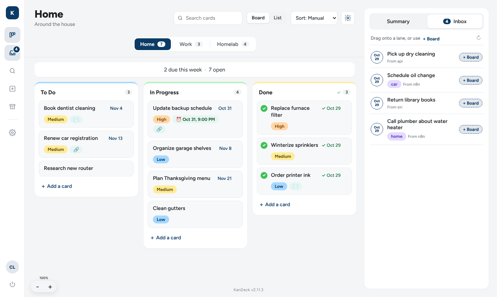
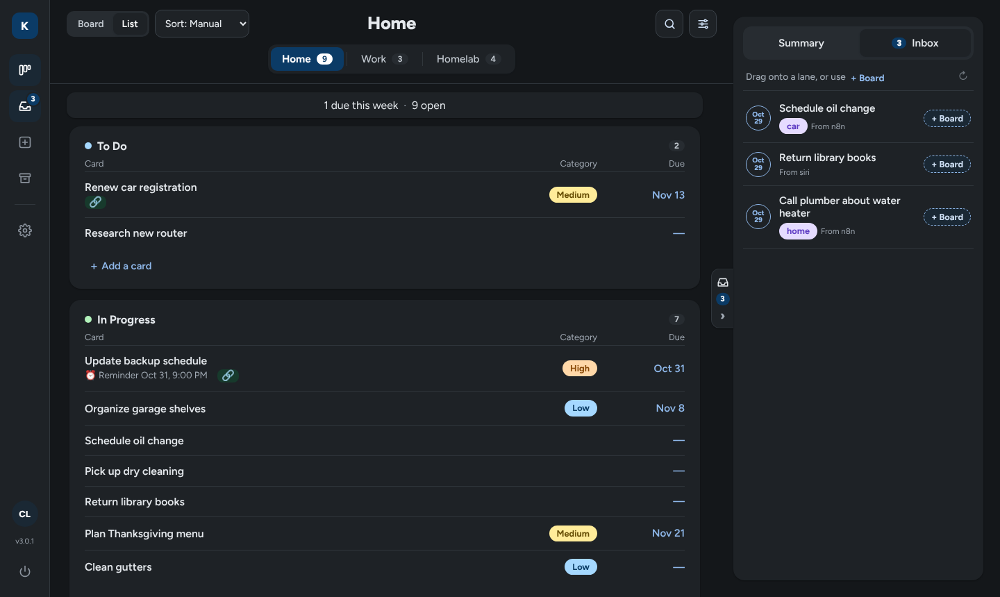
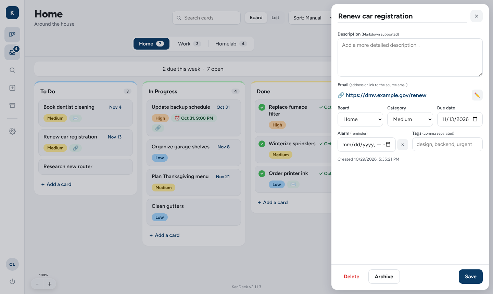
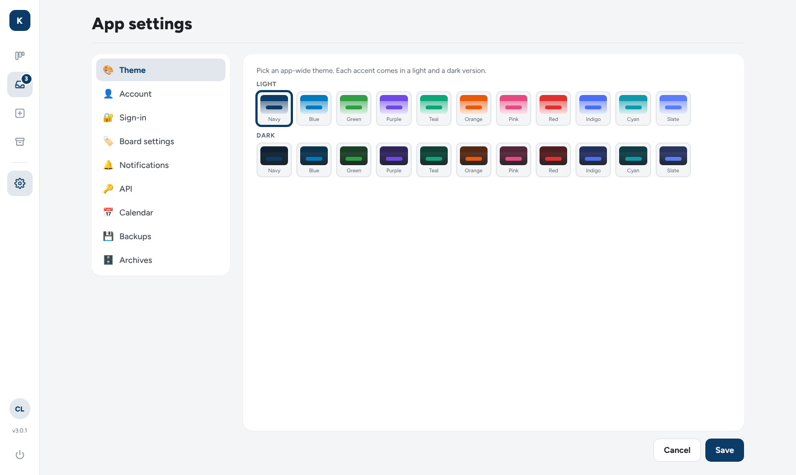

# 🗂️ KanDeck

A dead-simple, **self-hosted, single-user** Kanban board — no accounts, no cloud,
no clutter. All of your data lives in plain JSON files on your own machine.

KanDeck started as a search for a genuinely simple kanban board that I could
self-host and actually own. It's a single-user app: you create one login and
your boards are yours. It exposes a **REST API** so other apps and automations
(scripts, [n8n](https://n8n.io), …) can create and review the tasks on your
board.




---

## Contents

- [Features](#features)
- [Screenshots](#screenshots)
- [Quick start (local)](#quick-start-local)
- [Docker](#docker)
- [Configuration & secrets](#configuration--secrets)
- [Exposing KanDeck publicly](#exposing-kandeck-publicly)
- [Reset a forgotten login](#reset-a-forgotten-login)
- [Using KanDeck](#using-kandeck)
- [Done lane & completed dates](#done-lane--completed-dates)
- [Archiving boards](#archiving-boards)
- [Calendar feed (.ics)](#calendar-feed-ics)
- [REST API](#rest-api)
- [Notifications](#notifications)
- [Backups](#backups)
- [Building the Docker image (CI)](#building-the-docker-image-ci)
- [Privacy & License](#privacy--license)

---

## Features

- **Boards, columns, cards** with drag-and-drop (within and between columns);
  add / rename / reorder / delete columns per board.
- **Cards** with subject, Markdown description, due date, priority, tags, and
  archive. The **last lane is always the done lane** — cards get a completed
  date when they land there, and can auto-archive after N days.
- **Archive boards** instead of deleting them; restore or permanently delete
  from **App Settings → Archives**.
- **Calendar feeds** — read-only `.ics` subscription links per board, plus one
  app-wide feed covering every board and the Inbox (dated cards as events,
  undated cards as to-dos).
- **What's new** — after an update, a window shows the new version's changes
  and the 10 releases before it; click the version number to reopen it.
- **App-level categories** (priorities) with editable, high-contrast colors that
  apply across every board.
- **Inbox** — a capture area fed by the REST API / webhooks. Drag items onto a
  board, or use each card's **⋮ "send to board"** menu.
- **Search-as-you-type** across all boards; jumps straight to the card.
- **Themes** — 20 presets (10 light + 10 dark) with a vertical gradient wash;
  category and badge colors are user-editable with automatically-readable text.
- **REST API** with a date-filtered task-query endpoint for automations.
- **Notifications** — scheduled email + Discord task summaries plus card-moved
  Discord pings.
- **Backups** — manual and automatic (daily / weekly / monthly with retention);
  a full snapshot of boards **and** settings, with one-click restore.
- **Security** — single username + password login (bcrypt), revocable JWT
  cookie sessions, spoof-proof login rate-limiting, a locked first-run setup,
  security headers (CSP, anti-framing, HSTS), API-key auth, and secrets
  encrypted at rest.
- **No database.** Everything is flat-file JSON. Runs offline. Mobile-responsive.

---

## Screenshots

A board with the inbox open — priority categories, due dates, tags, and a
complete lane with check-off:


The same board in a dark theme (light and dark presets share an accent, so the
🌓 button flips between them):



<table>
  <tr>
    <td width="50%"><br><sub>Card details — description (Markdown), category, due date, and tags.</sub></td>
    <td width="50%"><br><sub>App Settings — 20 theme presets plus Categories, Lane colors, Notifications, API, and Backups.</sub></td>
  </tr>
</table>

---

## Quick start (local)

Requires **Node.js ≥ 18**.

```bash
git clone https://github.com/cwland/KanDeck.git
cd KanDeck
npm install
cp .env.example .env          # then edit — at minimum set a strong JWT_SECRET
npm run dev                   # http://localhost:8080  (auto-reload via nodemon)
```

On first visit you'll be asked to **create your login** (username + password, min
12 characters). That's it —
there's no signup, no external service.

For a plain (non-reloading) run: `npm start`.

---

## Docker

The published image is multi-arch (amd64 + arm64). Use it directly, or build
from source.

### docker-compose (recommended)

Create a `.env` next to your `docker-compose.yml` with your secrets (see
[Configuration](#configuration--secrets)), then:

```yaml
services:
  kandeck:
    image: ghcr.io/cwland/kandeck:latest   # or: build: .
    container_name: kandeck
    restart: unless-stopped
    ports:
      - "8080:8080"
    environment:
      NODE_ENV: production
      PORT: "8080"
      DATA_DIR: /app/data
      JWT_SECRET: ${JWT_SECRET:?set JWT_SECRET in .env}   # required, >= 32 chars
      SECRETS_KEY: ${SECRETS_KEY:-}                        # recommended
      SESSION_TTL: ${SESSION_TTL:-7d}
      API_KEY: ${API_KEY:-}                               # optional; you can also make one in the UI
    volumes:
      - ./data:/app/data                                  # your data lives here
```

```bash
docker compose up -d
```

> Email/Discord notifications, backup schedule, and the API key are configured
> **in the app** (App Settings), not via environment variables.

Your boards, settings, and backups persist in the bind-mounted `./data` directory
and survive container rebuilds.

### Behind a reverse proxy

KanDeck speaks plain HTTP; terminate TLS at a reverse proxy (Caddy, Nginx Proxy
Manager, Traefik, Cloudflare Tunnel, …). Use a **trusted certificate** so browsers
and calendar apps (which refuse self-signed certs for subscriptions) can connect,
and set **`TRUST_PROXY=1`** so login rate-limiting sees real client IPs. See
[Exposing KanDeck publicly](#exposing-kandeck-publicly).

---

## Configuration & secrets

All configuration is via environment variables (or a `.env` file). The full list
is in [`.env.example`](.env.example). The ones that matter:

| Variable | Required | Purpose |
|----------|----------|---------|
| `JWT_SECRET` | **Yes (production)** | Signs session cookies. The server **refuses to start** in production if this is unset, the default, or shorter than 32 characters. Generate with `openssl rand -base64 32`. |
| `SECRETS_KEY` | Recommended | Encrypts secrets at rest (the SMTP password). Decoupled from `JWT_SECRET` so you can rotate the session secret independently. If blank, `JWT_SECRET` is used. Generate with `openssl rand -base64 32`. |
| `TRUST_PROXY` | **Yes, behind a proxy** | Set to `1` when KanDeck sits behind one reverse proxy / tunnel, so the real client IP is used for login rate-limiting and HTTPS is detected for HSTS. Leave unset when exposed directly (then `X-Forwarded-For` is ignored and can't be spoofed). Also accepts Express values like `loopback`. |
| `SETUP_TOKEN` | Optional | A one-time secret required to create the first login. Without it, first-run setup only works from a direct local-network request — so a stranger can't claim a fresh install on a public IP. |
| `API_KEY` | Optional | A static API key for external tools. You can also generate/rotate one in **App Settings → API**. |
| `APP_URL` | Recommended behind a proxy | Public base URL (e.g. `https://kandeck.example.com`). Used for links in notifications and for calendar-feed URLs. If blank, feed URLs use whatever address you opened KanDeck on. |
| `DATA_DIR` | Optional | Where the JSON store lives (default `./data`). |
| `SESSION_TTL` | Optional | Session lifetime (default `7d`). |
| `BACKUP_CRON`, `BACKUP_RETENTION` | Optional | Pre-UI fallbacks; the real schedule/retention are set in **App Settings → Backups**. |

Keep your `.env` **out of source control** (it's already gitignored).

---

## Exposing KanDeck publicly

KanDeck is built to be safe to put on the internet (for example so calendar
apps can reach your `.ics` feeds), but check these first:

1. **HTTPS only** — put it behind a reverse proxy or Cloudflare Tunnel with a
   trusted certificate. Never publish plain HTTP on port 8080.
2. **`TRUST_PROXY=1`** behind that proxy, so the login throttle (10 failures per
   IP, 100 overall, per 15 minutes) uses real client IPs.
3. **Strong secrets** — a long random `JWT_SECRET` (the server refuses weak ones
   in production) and a password of at least 12 characters.
4. **Calendar feeds** are the only thing reachable without logging in, and each
   is protected by its own secret link — rotate one if it leaks.
5. **Optional extra layer:** with Cloudflare, put **Cloudflare Access** in front
   of the app and add a *bypass* rule for `/ics/*` (so calendars can fetch
   feeds) and a service token for `/api/*` (n8n / scripts). Add a rate-limit
   rule for `/api/auth/login` too.

What KanDeck does on its own: bcrypt-hashed password, `httpOnly` + `SameSite`
session cookies that can be revoked (**Log out all sessions**, password
change), a first-run setup that strangers can't claim (local network or
`SETUP_TOKEN` only), security headers on every response (CSP, `X-Frame-Options`,
`nosniff`, `no-referrer`, and HSTS — sent only over HTTPS for the hostname in
`APP_URL`, so internal/LAN proxy names are never pinned), and no `X-Powered-By`.

---

## Reset a forgotten login

KanDeck is single-user and offline, so there's no email-based "forgot password"
flow — but because you host it yourself, resetting takes one command. The
password is only ever stored as a **bcrypt hash** in `config.json`, so this sets
a new one rather than recovering the old one. Your boards, settings, backups and
API key are left untouched, and every existing session is signed out.

**Docker** — run it inside the running container:

```bash
docker compose exec kandeck npm run reset-password -- <username> <new-password>
```

**Local / bare-metal:**

```bash
npm run reset-password -- <username> <new-password>
```

Running it with **no arguments** clears the login instead; the app then shows
first-run setup, which only works from your local network (or with
`SETUP_TOKEN`).

**If the container won't start** (so you can't exec into it), edit
`./data/config.json` on the host: set `"passwordHash": null` and
`"username": null`, then create a new login from your local network.

> Passing a password as an argument leaves it in your shell history; clear it
> afterwards (e.g. `history -d`) if that matters to you.

---

## Using KanDeck

- **Switch boards** from the bottom bar → *Switch board*. Create a new board with
  the **＋** next to the search.
- **App Settings** (⚙️, top-right) is tabbed: Theme, Account, Categories, Lane
  colors, Notifications, API, Calendar, Backups, Archives. A single **Save**
  applies everything (the Account, API, Calendar and Archives tabs act
  immediately).
- **Account** (App Settings) changes your username or password (current password
  required) and has **Log out all sessions**. Changing the password signs out
  every other browser.
- **Board Settings** (⚙️, board area) manages that board's lanes, card display
  fields, the done-lane window, the calendar feed, archived cards, and
  **Archive board**.
- **Inbox**: items arriving via the API land here for triage — drag them onto a
  board or use the card's **⋮** menu to send it to a board's first column.
- **What's new**: the first time you open KanDeck after an update, a window
  lists what changed in the new version plus the previous 10 releases (newest
  first). Dismiss it and it won't appear again until the next version. Click the
  **KanDeck v…** version label at the bottom of the Inbox to reopen it.
  Release notes live in [`CHANGELOG.md`](CHANGELOG.md).

---

## Done lane & completed dates

- The **last lane on a board is always the done lane**, whatever it's named.
  Reorder lanes in Board settings and whichever lane is last becomes "done"
  (marked **✓ Done** in the lane editor).
- A card gets a **completed date** each time it enters the done lane — by
  dragging it there or clicking its check circle. Reordering inside the done
  lane keeps the date; moving a card out clears it. The date shows as a green
  **✓ date** badge on cards in the done lane, and as **✓ Completed …** in the
  card's detail window.
- **Auto-archive done tasks after X days** (Board settings; `0` = never)
  archives done-lane cards that many days after their completed date (checked
  hourly and whenever you save the setting). Archived cards keep their completed
  date and stay in the done lane, hidden — click the small **archive-box icon**
  at the right of the done lane's title to show or hide them (it shows how many
  are archived; remembered per board, per browser). Open one and
  click **Unarchive** to bring it back; it then gets a fresh X-day countdown.
  Archived cards also appear under **Archived cards** in Board settings.

## Archiving boards

**Board settings → Archive board** hides a board from the board switcher,
search, notifications and calendar feeds, keeping all of its cards.
**App Settings → Archives** lists archived boards with **Restore** and
**Delete** (permanent — though existing backups still contain the board).

## Calendar feed (.ics)

Each board can publish a read-only iCalendar feed that Google, Apple, Outlook
and other calendar apps can subscribe to. Turn it on in **Board settings →
Calendar feed**, then **Copy** the link or click **Subscribe**.

- Cards **with** a due date → all-day `VEVENT`s on that date.
- Cards **without** a due date → `VTODO`s. (Google Calendar ignores to-dos;
  Apple/Outlook/Thunderbird support varies for subscribed feeds.)
- Options: **Include card descriptions** and **Include done tasks** (both off
  by default). Archived cards and archived boards are never published.

**All boards + Inbox.** **App Settings → Calendar** publishes one app-wide feed
(`/ics/all/<token>.ics`) with every active board's cards — titles prefixed
with the board, e.g. `[Home] Fix gate` — plus Inbox items as `[Inbox] …`
(toggle **Include Inbox items**, on by default). Same descriptions / done-tasks
options, same secret-link model, and its own **Generate new link**; it's
independent of the per-board feeds.

**Security.** Calendar apps can't log in, so the feed is protected by a random
192-bit token in its URL (`/ics/<boardId>/<token>.ics`) — treat the link like a
password.

- Feeds are **off by default**; turning one off revokes the link, and
  **Generate new link** rotates it (old link dies immediately).
- Every failure (wrong token, disabled feed, archived/unknown board) returns
  the same `404`, so the endpoint can't be used to discover boards.
- Responses are read-only, `noindex`, and `no-referrer`.
- Descriptions are excluded unless you opt in.
- If KanDeck is internet-facing, consider a rate-limit rule for `/ics/*` at
  your proxy/CDN (e.g. Cloudflare), and set `APP_URL` so links use your public
  hostname.

---

## REST API

All endpoints are under `/api` and require auth: either an active browser session
or an API key sent as `Authorization: Bearer <key>` or `X-API-Key: <key>`.

| Method | Path | Purpose |
|--------|------|---------|
| `GET` | `/api/boards` | List active boards + summary meta (`?archived=1` → archived boards) |
| `GET` | `/api/boards/:id` | Full board (columns + cards) |
| `POST` | `/api/tasks` | Create a task (no `boardId` → Inbox; with `boardId` → that board) |
| `PUT` | `/api/tasks/:id` | Update or move a task |
| `GET` | `/api/tasks/query` | **Date-filtered task query** (see below) |
| `GET` | `/api/search?q=` | Search cards across all boards |
| `GET` | `/api/changelog` | Current version's release notes + previous 10, and whether they've been seen |
| `PUT` | `/api/changelog/seen` | Mark the running version's notes as seen |
| `GET` | `/api/inbox` · `POST` `/api/inbox` · `POST` `/api/inbox/:id/move` | Inbox |
| `POST` | `/api/boards/:id/archive` · `/api/boards/:id/unarchive` | Archive / restore a board |
| `DELETE` | `/api/boards/:id` | Permanently delete a board |
| `POST` | `/api/boards/:id/ics` | Enable the board's calendar feed (body `{"rotate":true}` → new token) |
| `PUT` | `/api/boards/:id/ics` | Feed options `{ includeDescriptions, includeCompleted }` |
| `DELETE` | `/api/boards/:id/ics` | Disable the feed (revokes the link) |
| `GET` | `/api/ics` · `POST` · `PUT` · `DELETE` | App-wide feed: read state · enable (`{"rotate":true}` → new token) · options `{ includeInbox, includeDescriptions, includeCompleted }` · disable |
| `GET` | `/ics/:boardId/:token.ics` | A board's feed — **no auth header**; the token is the credential |
| `GET` | `/ics/all/:token.ics` | The app-wide feed (all boards + Inbox) — token is the credential |

### Create a task

```bash
curl -X POST https://kandeck.example.com/api/tasks \
  -H "X-API-Key: $KANDECK_API_KEY" -H "content-type: application/json" \
  -d '{"subject":"Buy milk","priority":"high","dueDate":"2026-08-01"}'
```

### Query tasks (built for assistants)

`GET /api/tasks/query` returns a flat, **date-filtered** list of cards across all
boards, with the date math done server-side:

| Param | Values |
|-------|--------|
| `due` | `today` · `tomorrow` · `week` (next 7 days) · `overdue` · `none` · `any` |
| `status` | `open` · `complete` · `all` (defaults to `open`, or `complete` when `completedWithin` is set) |
| `completedWithin` | integer N — completed within the last N days |
| `board` · `priority` · `q` · `limit` | optional filters |

```bash
curl "https://kandeck.example.com/api/tasks/query?due=today" -H "X-API-Key: $KANDECK_API_KEY"
curl "https://kandeck.example.com/api/tasks/query?status=complete&completedWithin=7" -H "X-API-Key: $KANDECK_API_KEY"
```

Each task carries `boardName`, `columnName`, `subject`, `dueDate`, `dueInDays`,
`overdue`, `priority`/`priorityName`, `complete`, `completedDaysAgo`, plus a
top-level `summary` and `today`.

---

## Notifications

Configured in **App Settings → Notifications** (no env vars):

- **Scheduled summaries** — an email and/or Discord digest of your tasks
  (upcoming N days · due today · past due) on a time + weekday schedule you pick.
- **Card-moved** Discord pings when a card lands in a board's notify lane.

Email uses SMTP you provide (the password is encrypted at rest); Discord uses a
webhook URL. Each has a **Test** button that validates the connection before you
rely on it.

---

## Backups

In **App Settings → Backups**:

- **Backup now** / **Restore** at any time.
- **Automatic backups** — daily / weekly / monthly, with a "keep last N" retention.
- Each backup is a full snapshot of **boards *and* settings** (secrets stay
  encrypted). Restore takes a safety backup first, and older backups are pruned to
  your retention count. Backups are labeled Automated vs Manual in the list.

CLI: `npm run backup` makes a one-off snapshot.

---

## Building the Docker image (CI)

A GitHub Actions workflow
([`.github/workflows/docker-build.yml`](.github/workflows/docker-build.yml))
builds a **multi-arch image (linux/amd64 + linux/arm64)** and publishes it to the
GitHub Container Registry on every push to `main` and on version tags:

- `ghcr.io/<owner>/kandeck:latest` — default branch
- `ghcr.io/<owner>/kandeck:vX.Y.Z` and `:X.Y` — when you push a `vX.Y.Z` tag
- `ghcr.io/<owner>/kandeck:sha-<commit>` — always

It authenticates with the built-in `GITHUB_TOKEN` (no secrets to configure).
After the first run, set the package to **Public** in your repo's Packages
settings if you want anyone to pull it. To cut a release, bump `version` in
`package.json`, add a `## <version> — <date>` section to the top of
[`CHANGELOG.md`](CHANGELOG.md) (that's what the in-app **What's new** window
shows), then:

```bash
git tag v2.0.1 && git push origin v2.0.1
```

To cross-build locally from an Apple-Silicon Mac for an Intel/AMD server without
CI, use [`scripts/build-amd64.sh`](scripts/build-amd64.sh).

---

## Privacy & License

- **Privacy:** KanDeck has no telemetry and never phones home; your data stays in
  local files and it only contacts services **you** configure (SMTP /
  Discord). See [`PRIVACY.md`](PRIVACY.md).
- **License:** [MIT](LICENSE) — do essentially anything you want with it.

Contributions and forks welcome. KanDeck is single-user by design.
